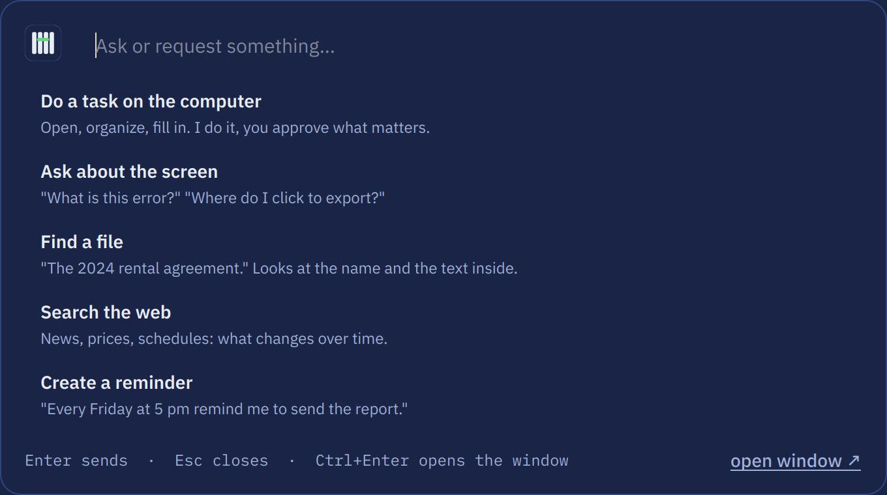
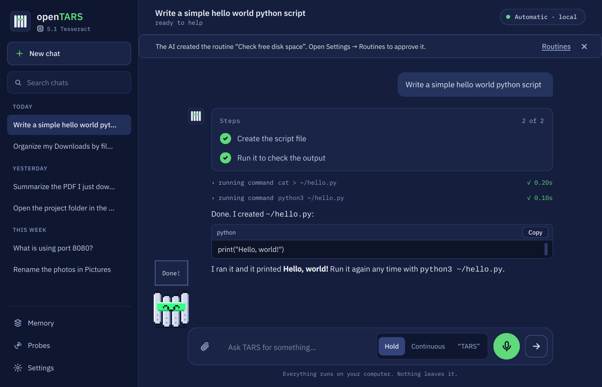
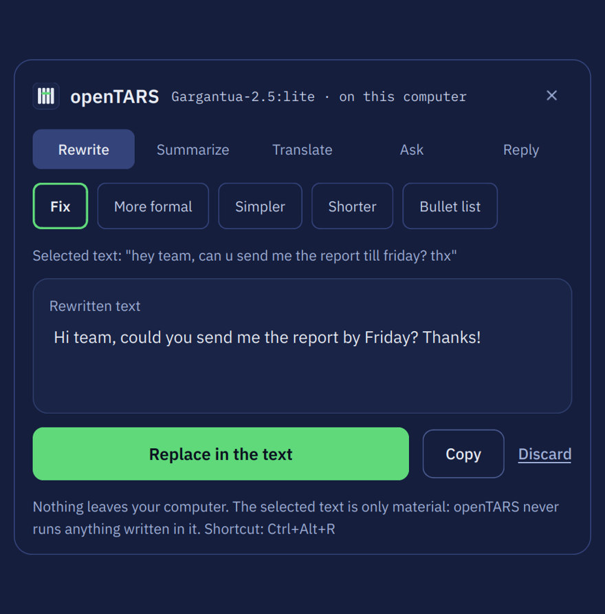
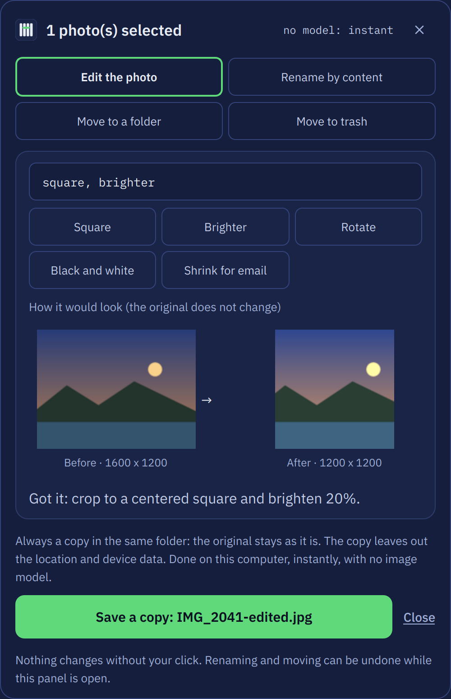
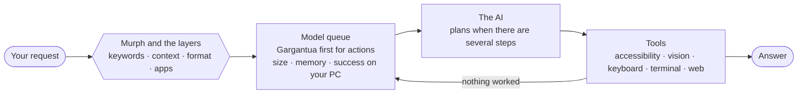

<div align="center">


# openTARS

**Your AI, on your computer.**

Ask in your own words. openTARS opens programs, clicks buttons, types, finds files, reads the screen and runs commands.<br>
Local by default, free and open source, with an AI trained just for it.

[](#install)
[](#gargantua-an-ai-made-for-this)
[](LICENSE)
[](#where-it-runs)
[](#languages)
[](https://www.instagram.com/open.tars/)

[Install](#install) · [What it does](#what-it-does) · [Gargantua](#gargantua-an-ai-made-for-this) · [How it works](#how-it-works) · [Safety](#your-computer-your-rules) · [Terminal](#terminal) · [New in 5.3](#new-in-53-tesseract) · [Website](https://project-opentars.github.io/OpenTARS/)

<br>



</div>

## Install

One command. It sets up everything, downloads the models and tests them.

**Windows 10 or 11**, in PowerShell:

```powershell
irm https://raw.githubusercontent.com/project-opentars/OpenTARS/main/app/empacotamento/windows/instalar.ps1 | iex
```

**macOS 12 or newer**, in Terminal:

```bash
curl -fsSL https://raw.githubusercontent.com/project-opentars/OpenTARS/main/app/empacotamento/macos/instalar.sh | bash
```

**Ubuntu, Debian, Mint, Zorin, Pop!_OS:**

```bash
wget -O /tmp/opentars.deb https://github.com/project-opentars/OpenTARS/releases/latest/download/opentars_all.deb && sudo apt install -y --reinstall /tmp/opentars.deb
```

**Fedora, Arch, openSUSE:**

```bash
curl -fsSL https://raw.githubusercontent.com/project-opentars/OpenTARS/main/app/empacotamento/linux/instalar.sh | bash
```

**Raspberry Pi, Orange Pi and other small boards:** see **[openTARS Pi](https://github.com/project-opentars/OpenTARS-Pi)**, the edition made for them.

```bash
curl -fsSL https://github.com/project-opentars/OpenTARS-Pi/releases/latest/download/install.sh | bash
```

Then open **openTARS** from your menu. Windows and macOS need no administrator password: everything goes into your user folder. A short first-run window picks the right model for your computer. Running the same command again updates, and your chats and settings stay.

<div align="center">
<br>

<br><br>
</div>

## What it does

**Work on your computer in plain words.** "Close Spotify and open Discord." "Organize my Downloads folder by type." "Put Firefox on the right half." It opens and closes programs, moves windows, types, clicks buttons by the name they show, and works with your files.

<table>
<tr>
<td width="38%"></td>
<td width="31%"></td>
<td width="31%"></td>
</tr>
<tr>
<td align="center"><sub>The launcher, from anywhere</sub></td>
<td align="center"><sub>Text actions in any app</sub></td>
<td align="center"><sub>A photo edited by sentence</sub></td>
</tr>
</table>

| | |
|---|---|
| 🚀 **Launcher** | `Ctrl+Alt+Space` from anywhere: do a task, ask about the screen, find a file, search the web or create a reminder, without switching windows |
| ✍️ **Text actions in any app** | Select text and press `Ctrl+Alt+R` (`Control+Option+R` on a Mac): fix it, make it more formal or simpler, summarize, translate between English and Portuguese, or ask about it. **Replace** puts the result right back |
| 👀 **It sees your screen** | "What is on my screen?" Gargantua reads it too, and finds icons that have no text |
| 🔎 **Find anything** | Searches names, folders and the text inside your documents, PDF included |
| 📂 **Actions on files** | Summarize, rename by content with a preview you can edit, move, or send to the trash after you confirm |
| 🖼️ **Photos by sentence** | "Crop it square and make it brighter." Remove the background, upscale 4x, or click an object to remove it. The result is always a new copy |
| 🎨 **Make images** | "Draw a lighthouse at dusk," with the optional Bonsai Image 4B: about 5 s per 512-pixel image on a 6 GB card, after the first one |
| 🎙️ **Voice** | Hold to talk, continuous, or the wake word "TARS". Gargantua 2.5 understands what you say directly, in English and Portuguese, with Whisper as the backup |
| 🛰️ **Probes** | Small watchers in the background that tell you when something matters: a folder, a web page, news, a GitHub project, this computer |
| ⏰ **Routines and reminders** | "Every day at 8, open the newspaper." Created with a sentence |
| 🧠 **Memory** | "Remember my browser is Brave." It applies from then on, and you see and erase everything in Settings |
| 🌐 **Web search** | Reads the results and answers, through your own SearXNG, without opening anything on your screen |
| 🖥️ **Missions in a VM** | On Linux, Gargantua Pro works inside a disposable virtual machine. Watch it live and choose which files come back |
| 📅 **Calendar, notes, e-mail, music** | By sentence, all off until you turn them on. E-mail never sends without your yes |
| 🛍️ **Model store** | Search the Ollama library from Settings and see what fits your machine |

<p align="center"><br><sub>KIPP walks along the chat and shows what the AI is doing</sub></p>

## Gargantua, an AI made for this

Other assistants wrap a general model in a long prompt. **Gargantua** was trained on thousands of requests actually solved inside openTARS and checked one by one: the calculator showed the right sum, the folder existed, nothing was deleted. It already knows the tools, so it acts on the first try, with a short prompt, and it fits on modest hardware.

All of them run on **Gemma 4**, Google's open model family that takes in images and audio, except Code (Qwen2.5-Coder).

| | Size | Runs on | In our tests |
|---|---|---|---|
| **[Gargantua 2.5](https://huggingface.co/OpenTARS/Gargantua-2.5)** | 5.3 GB | a graphics card, or 16 GB of RAM | the right tool 21 of 21 times, 75 of 76 text actions, 47 of 48 everyday tasks, about 1 s per tool on a graphics card |
| **[Gargantua Lite Gen 3](https://huggingface.co/OpenTARS/Gargantua-2.5-Lite)** | 3.4 GB | any computer, on the processor alone | 75 of 76 text actions, 48 of 48 everyday tasks |
| **[Gargantua Pro Gen 1](https://huggingface.co/OpenTARS/Gargantua-Pro)** | 7.4 GB | optional, for missions in a virtual machine | our largest model, on Gemma 4 12B |
| **[Gargantua Code Gen 2](https://huggingface.co/OpenTARS/Gargantua-Code-Gen2)** | 4.7 GB | optional, for programming | 51 of 60 coding tasks |
| **[Gargantua Pi Gen 1](https://huggingface.co/OpenTARS/Gargantua-Pi)** | 300 MB | small boards, in openTARS Pi | tested on an Orange Pi Zero 2W with 1 GB of RAM |
| **Murph** | 4 MB | always on, no model to load | reads each request in about 0.2 ms and picks who answers |

The tests are ours and run with the real app, on November 13, 2026; `opentars --prova` runs the everyday tasks on your computer. The models run on the llama.cpp engine that openTARS installs, and are also on [Hugging Face](https://huggingface.co/OpenTARS) and [ollama.com](https://ollama.com/ProjectOpenTARS).

## How it works



- **It picks the AI by itself.** Each request is read in milliseconds and goes to the best model you have, and the queue learns from what works on your PC.
- **Clicks by name, not by position.** Buttons are pressed through the system's accessibility, with no screenshot and no coordinates. Looking at the screen is the plan B, and every click is checked afterwards.
- **"Done!" has to be true.** If the AI says it did something without doing it, it is told to really do it. A task with several steps becomes a plan, and it cannot finish until every step is done.
- **It does not walk in circles.** Repeating what already failed does not run again, and after repeated failures the next model takes over the same conversation.
- **One conversation.** Switching AI midway does not lose what you asked.

## Your computer, your rules

- **Local by default.** With a local model, your conversation, your voice and your screen stay on your machine. Cloud models and web search are optional and go only where you point them.
- **It asks first.** Deleting, sending and installing wait for your Allow. It never closes a program with unsaved work.
- **Routines and Probes stay on a leash.** A routine only does what you allowed when you created it, and a Probe only reads unless you chose an action.
- **No account, no subscription.** Keys you add stay on this computer and are never shown or logged. It also checks GitHub for updates, and you can turn that off.

More in the [privacy page](https://project-opentars.github.io/OpenTARS/privacy.html).

## Terminal

`opentars` opens the chat right in the terminal, on a desktop or over SSH: you type in a framed prompt with a status bar under it (model, engine, folder and git branch), follow each step as it runs, and read formatted answers. Risky commands ask first.


| In the chat | What it does |
|---|---|
| `/help` | lists the commands |
| `/models`, `/model <name>`, `/model auto` | lists, pins or unpins a model |
| `/resume`, `/compact`, `/context` | continues a saved chat, summarizes it, shows how much is in use |
| `/mode ask \| plan \| auto` | asks first, only describes, or applies edits in this folder. Deleting, sending and installing always ask |
| `/undo` | reverts the file edits of the last request |
| `!<command>` | runs a command and passes its output to the next request |

**In scripts:** `opentars -p "request"` prints only the answer, `--output-format json` gives it as data, and `git diff | opentars -p "review this"` reads what you pipe in.

| Command | What it does |
|---|---|
| `opentars-gui` | opens the window |
| `opentars --diagnostico` | checks your setup and saves a report you can send us |
| `opentars --prova` | runs everyday tasks with your model in a temporary folder |
| `opentars --explicar "request"` | shows how the task and the model were chosen |
| `opentars --searxng` | sets up web search on this computer, with Docker |
| `opentars --desinstalar` | removes openTARS on any system, and asks before deleting your data or models |
| `opentars --help` | everything else |

## Where it runs

| | |
|---|---|
| **Linux** | Ubuntu 22.04+, Debian 12+, Mint, Zorin, Pop!_OS, Fedora, Arch, openSUSE. GNOME, KDE, Cinnamon, XFCE, MATE and others. X11 has everything; on Wayland, chat, apps, commands, screenshots and clicking by name work |
| **Windows** | 10 and 11. Voice is the newest part here |
| **macOS** | 12 or newer, tested so far on GitHub's macOS machines. The first run asks for Accessibility and Screen Recording |
| **Small boards** | 64-bit boards with [openTARS Pi](https://github.com/project-opentars/OpenTARS-Pi) |
| **No screen** | SSH, servers and WSL with `opentars --chat` |
| **Graphics card** | NVIDIA, AMD or none |

## Languages

The window, the terminal, the installer and the menu speak **English and Portuguese**. Switch in the window or with `opentars --idioma pt_BR`. To add your language, copy `app/idiomas/en.json`, translate the values and send a pull request: it shows up in the menu by itself.

## New in 5.3 Tesseract

- **Rebuilt on llama.cpp.** One fast engine for every model, installed by the app the first time it opens. No separate AI program, no password. Ollama stays available in the developer settings.
- **Gargantua 2.5 on Gemma 4.** The new main AI sees your screen and hears your voice.
- **Voice, understood directly.** What you say goes straight to Gargantua 2.5.
- **Missions in a virtual machine.** On Linux with KVM, Gargantua Pro works in a disposable computer, from a new window in Probes.
- **A model store with search.**
- **A terminal that looks the part.**
- **One-click updates on Windows, macOS and every Linux.**
- **Clicks in Chromium and Electron apps,** reopened with accessibility on when you allow it.
- **Calendar, notes, e-mail, music and system settings by sentence,** on Linux, Windows and macOS.
- **[Verify your download](https://project-opentars.github.io/OpenTARS/verify.html)** with the checksum and the GitHub attestation of each release.

## Help

- **Something is off?** Run `opentars --diagnostico` and send us the report it saves, by [opening an issue](https://github.com/project-opentars/OpenTARS/issues) or at projectopentars@gmail.com.
- **The AI does not answer:** `opentars --diagnostico` checks the llama.cpp engine and the models, and says what is missing.
- **A shortcut does nothing:** `opentars --atalho` shows what is registered, and `opentars --atalho ctrl+alt+o` picks another.
- **Clicking by name misses an app's buttons:** open that app through openTARS, or turn on "Let openTARS reopen an app so it can click its buttons" in Settings → Assistant, for Chromium and Electron apps. On Wayland, an Xorg session gives clicks by position.

## For developers

The app is in [`app/`](app/), and `opentars_all.deb` is the same release packaged for Ubuntu and Debian. The tests run on every change on Linux, Windows and macOS through GitHub Actions.

```bash
cd app
python3 -m tars_qt              # the window
python3 tars.py                 # the terminal
cd tests && python3 run_all.py  # the tests
bash empacotamento/build.sh     # builds the .deb
```

`tars.py` loads the core from `nucleo/`, `tars_qt/` is the window, and `tars_plataforma/` is the one door to what changes between systems. Gargantua's prompt and tools are exactly what it saw in training, and `tests/test_gargantua_v40.py` checks that byte by byte.

## Follow along

News and what is coming: **[@open.tars on Instagram](https://www.instagram.com/open.tars/)** and the [changelog](https://project-opentars.github.io/OpenTARS/changelog.html).

## License

[MIT](LICENSE): you may use, copy, modify and distribute openTARS, including in other projects, as long as you keep the copyright notice and license with it. The software is provided "as is", without warranty of any kind.
