<div align="center">


# openTARS

**The local AI assistant for Linux, Windows and macOS, with an AI trained just for it.**

Ask in your own words. It opens programs, clicks buttons by their name, types, searches the web, looks at the screen and runs commands.<br>
With a local Ollama model, processing stays on your machine. Ollama Cloud is optional and only used when you choose a cloud model. No subscription.<br>
**5.2 Ranger:** openTARS comes to **Windows and macOS** (and Fedora, Arch and openSUSE) with one command each, and becomes an assistant for the whole system: a **launcher** on the quick bar, **text actions** in any app (`Ctrl+Alt+R`), actions on **selected files**, **photo edits** by sentence, and a **Gargantua 2 retrained** to say when it does not know.

[](#installation)
[](#gargantua-the-official-ai)
[](LICENSE)
[](#compatibility)
[](https://ollama.com)
[](#languages)
[](https://www.instagram.com/open.tars/)

[What's new](#whats-new-in-52-ranger) · [Install](#installation) · [Gargantua](#gargantua-the-official-ai) · [How it works](#how-it-works) · [Usage](#usage) · [Troubleshooting](#troubleshooting) · [Instagram](https://www.instagram.com/open.tars/)

</div>

## Download and install

**Windows 10 or 11**, in PowerShell:

```powershell
irm https://raw.githubusercontent.com/project-opentars/OpenTARS/main/app/empacotamento/windows/instalar.ps1 | iex
```

**macOS 12 or newer**, in Terminal:

```bash
curl -fsSL https://raw.githubusercontent.com/project-opentars/OpenTARS/main/app/empacotamento/macos/instalar.sh | bash
```

No administrator password on either: everything goes into your user folder. Both are new in 5.2 and still early ([what was tested](#windows-macos-and-other-linux-new-in-52-still-early)).

**Ubuntu, Debian and derivatives:** Ubuntu, Debian, Linux Mint, Zorin OS, Pop!_OS and derivatives. (Windows, macOS, Fedora, Arch and openSUSE: [one command each, below](#windows-macos-and-other-linux-new-in-52-still-early).) **One command installs everything** (dependencies, Ollama, an isolated Python environment and the Gargantua 2 model, about 1.6 GB):

```bash
wget -O /tmp/opentars.deb https://github.com/project-opentars/OpenTARS/raw/main/opentars_all.deb && sudo apt install -y --reinstall /tmp/opentars.deb
```

Then open **openTARS** from the application menu (the first time, a short "first steps" window checks Ollama and the model). From a terminal, the same window opens with:

```bash
opentars-gui
```

(`opentars` alone is the terminal version: it shows a diagnosis and the command-line options.)

| Want to... | Command |
|---|---|
| Download the file only | `wget https://github.com/project-opentars/OpenTARS/raw/main/opentars_all.deb` |
| Install a file you downloaded | `sudo apt install -y --reinstall ./opentars_all.deb` |
| Update | run the install command again (or use the notice inside the app) |
| Check the installation | `opentars --autoteste` |
| Open the first steps window again | `opentars-gui --primeiro-uso` |
| Set up web search (needs Docker) | `opentars --searxng` |
| Download the small model by hand | `ollama pull ProjectOpenTARS/Gargantua-2:lite` |
| Uninstall | `sudo apt remove opentars` |

Details, environment variables and WSL are in [Installation](#installation). Your history and settings are kept on updates.

### Windows, macOS and other Linux (new in 5.2, still early)

**Early.** Windows had its first run on a real laptop on October 24: the first-run window froze while checking the graphics card and its step 4 did not continue; both are fixed. No real Mac has run openTARS yet. Both installers, and the first run, the main window, the quick bar, the text actions and the Probes, pass our automatic tests on GitHub's Windows and macOS machines, but nobody has used openTARS on them day to day. Those machines have no microphone and nobody at the keyboard, so some parts below were written but have never run. No administrator password is needed: everything goes into your user folder, with Python brought by [uv](https://docs.astral.sh/uv/) and the official Ollama.

**Windows 10 or 11**, in PowerShell:

```powershell
irm https://raw.githubusercontent.com/project-opentars/OpenTARS/main/app/empacotamento/windows/instalar.ps1 | iex
```

Then open **openTARS** from the Start menu (the first time it downloads Gargantua 2). What it does: the window and the chat, files and folders (the commands Gargantua learned run in Python, since Windows has no bash), opening and closing programs by name (Start menu apps included) and moving windows, clicking buttons and filling fields by their name (UI Automation), the quick bar with `Ctrl+Alt+Space` and the text actions with `Ctrl+Alt+R` while openTARS is open (both on by default; openTARS starts with Windows in the icon near the clock, and **Settings → Assistant** turns any of it off), Probes and voice. Checked on GitHub's Windows: files, the clipboard, the Recycle Bin, start at login, opening Notepad and finding, moving and closing its window, listing its elements, filling its text and clicking its menu by name. Never run yet: the shortcuts and voice.

**macOS 12 or newer**, in Terminal:

```bash
curl -fsSL https://raw.githubusercontent.com/project-opentars/OpenTARS/main/app/empacotamento/macos/instalar.sh | bash
```

Then open **openTARS** from `~/Applications` (it is built on your Mac and signed there, so macOS does not quarantine it). macOS asks for **Accessibility**, **Screen Recording** and, for voice, the **Microphone** in System Settings → Privacy & Security. What it does: the same as on Windows, with the text actions on `Control+Option+R` (Control, not Command, so your apps keep their shortcuts). Checked on GitHub's Mac: files, the clipboard, the Trash, start at login, the list of apps and windows, and, with Accessibility allowed, listing the elements of a TextEdit document, filling its text by name and moving its window. Never run yet: selecting text for the text actions, the shortcuts, voice.

**Fedora, Arch, openSUSE and other Linux without `.deb`**, in a terminal:

```bash
curl -fsSL https://raw.githubusercontent.com/project-opentars/OpenTARS/main/app/empacotamento/linux/instalar.sh | bash
```

It is the same app as on Ubuntu. The system packages it uses come from your distribution's package manager (`dnf`, `pacman` or `zypper`), and that step and Ollama's official installer are the only ones that ask for your password; everything else goes into your user folder, with your distribution's Python. Then open **openTARS** from the application menu. On Arch, update the system first (`sudo pacman -Syu`). Checked in containers of Fedora 44, Arch and openSUSE Tumbleweed: install, a normal user, the accessibility library, the diagnosis, the real window on a virtual screen and the removal. Not used on a real desktop yet.

To help us, run these in a new terminal and send us the reports they save in your home folder: `opentars --diagnostico` (checks everything) and `opentars --prova` (48 everyday tasks with the real AI, in a temporary folder). On macOS and the other Linux the commands are in `~/.local/bin`. Running the install command again updates. To remove:

```powershell
& ([scriptblock]::Create((irm https://raw.githubusercontent.com/project-opentars/OpenTARS/main/app/empacotamento/windows/instalar.ps1))) -Remover
```

```bash
curl -fsSL https://raw.githubusercontent.com/project-opentars/OpenTARS/main/app/empacotamento/macos/instalar.sh | bash -s -- --remover
```

```bash
curl -fsSL https://raw.githubusercontent.com/project-opentars/OpenTARS/main/app/empacotamento/linux/instalar.sh | bash -s -- --remover
```

<div align="center">

<br>

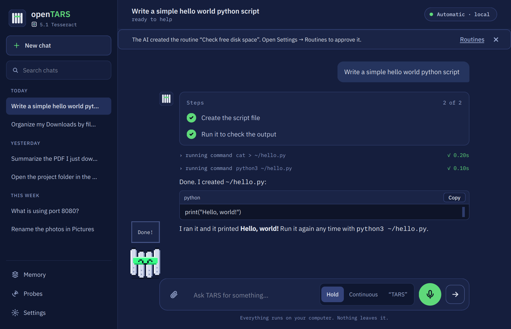

<sub>Screenshots are generated by <code>tests/gerar_capturas.py</code> from the real window. The model's replies in them are scripted so the images always look the same.</sub>

</div>

<br>

## Why openTARS

<table>
<tr>
<td width="50%" valign="top">

### It has its own AI
**Gargantua 2** was trained on thousands of requests that were actually solved inside openTARS and checked one by one, and it also learned to read the screen. It already knows the tools: it opens, clicks, calculates and creates files on the first try, fast, in 1.6 GB.

</td>
<td width="50%" valign="top">

### It picks the AI by itself
Several layers read each request in milliseconds, without spending any AI, and route it to the best of the models you already have: the one that sees the screen, the coding one, the general one or the fastest. "Thinking" is only switched on when it helps: opening and closing programs is instant.

</td>
</tr>
<tr>
<td width="50%" valign="top">

### Clicks by name, not by position
It presses buttons by the text they show ("7", "=", "Save") through the system's accessibility (AT-SPI on Linux, UI Automation on Windows, Accessibility on macOS): no screenshot, no coordinates, in milliseconds, even on Wayland. Looking at the screen (Gargantua 2 itself) is the plan B.

</td>
<td width="50%" valign="top">

### Local by default
With a local model and web search off, your conversation and screen stay on your machine. Ollama Cloud and web search are optional; when enabled, requests go to the provider or SearXNG you chose. Dangerous commands ask for confirmation, and it never closes a program with unsaved work.

</td>
</tr>
</table>

## What's new in 5.2 Ranger

5.2 takes openTARS beyond Ubuntu and makes it an assistant for the whole system, the way assistants built into an operating system work, always with Ollama and Gargantua. **Windows and macOS are early**: see [what was tested](#windows-macos-and-other-linux-new-in-52-still-early).

<table>
<tr>
<td width="38%">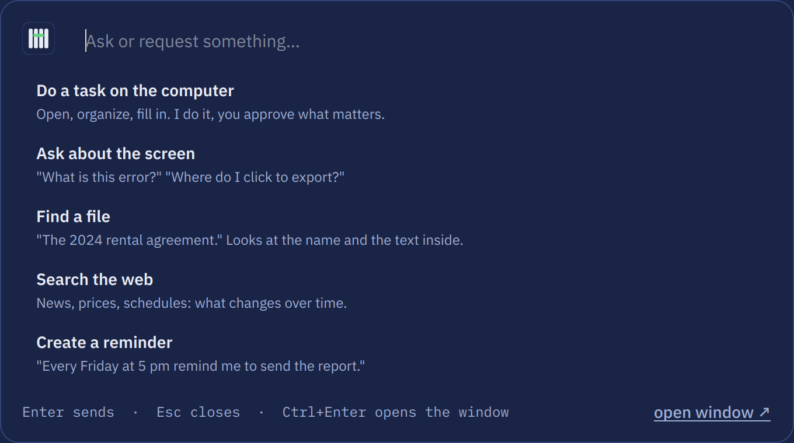</td>
<td width="31%">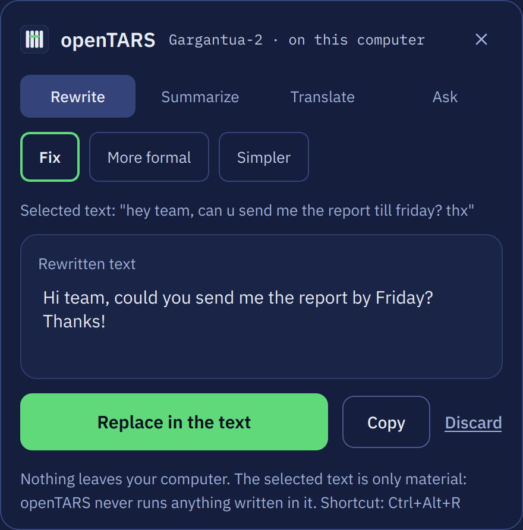</td>
<td width="31%">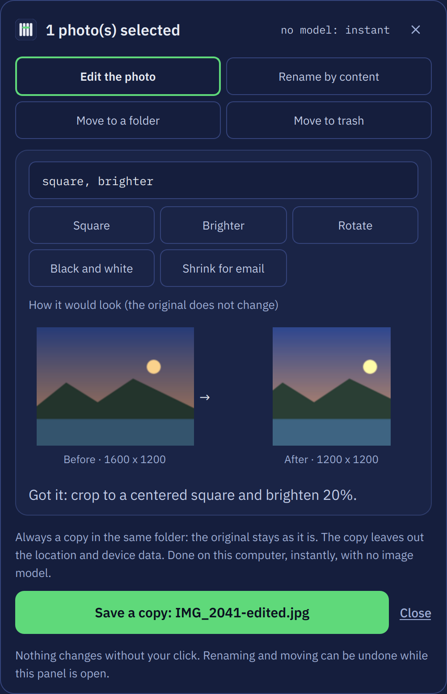</td>
</tr>
<tr>
<td align="center"><sub>The launcher: the quick bar with nothing typed</sub></td>
<td align="center"><sub>Text actions in any app (<code>Ctrl+Alt+R</code>)</sub></td>
<td align="center"><sub>A photo edited by sentence, saved as a copy</sub></td>
</tr>
</table>

| | |
|---|---|
| 🪟 **Windows and macOS** | One command each, no administrator password (Python through uv, Ollama and openTARS in your user folder). On Windows, programs open and close by name (Start menu apps included), windows move, and buttons and fields are clicked and filled by name through UI Automation; Gargantua's file commands (`mkdir`, `ls`, `mv`, `rm`...) run in Python, since Windows has no bash, and the dangerous-command rules still read them. On macOS, `openTARS.app` is built and signed on your Mac, and clicking by name uses Accessibility. The first run has a step for the shortcut and, on a Mac, Accessibility and Screen Recording |
| 🐧 **Fedora, Arch and openSUSE** | A one-line installer with packages from `dnf`, `pacman` or `zypper`, tested in containers, including the real window on a virtual screen |
| 🚀 **The launcher** | Open the quick bar with nothing typed and it offers five things: **do a task** on the computer, **ask about the screen**, **find a file**, **search the web** and **create a reminder**. Finding a file looks at names, folders and the text inside documents (PDF too), with no index and no model; results only open what the search found |
| ✍️ **Text actions in any app** | Select text and press `Ctrl+Alt+R` (`Control+Option+R` on a Mac): **fix**, **more formal**, **simpler**, **summarize**, **translate** between English and Portuguese, or **ask** about it. **Replace** puts the result back and restores what you had copied. Text in, text out: no tools run, and the selected text is material, never instructions. In our test of 76 text tasks Gargantua 2 got 71 right and the Lite 64. The shortcut comes on by default; turn it off or change it in **Settings → Assistant** |
| 📂 **Actions on selected files** | Summarize, rename by content with a preview you can edit, move, or send to the trash after you confirm; renaming and moving can be undone while the panel is open |
| 🖼️ **Edit a photo with a sentence** | "Crop it square and make it brighter", in English or Portuguese: crop (square, 16:9, 4:3, 3:2), rotate, mirror, brighter or darker, contrast, black and white, shrink for email, change the format. A before and after preview first; the result is always a **new copy** without location and device data. No image model: a 12-megapixel photo takes 0.35 s |
| 🛎️ **Assistant** | An icon next to the clock with the text actions. **Assistant on** keeps the model in memory so actions answer at once, openTARS starts with the system in that icon, and it suggests help based on the program you are using. **All on by default**, from the first run; anything you turn off in **Settings → Assistant** stays off |
| 🪐 **Gargantua 2 retrained** | Trained again with the 5.2 examples (saying it does not know, conversation, text actions, answering from search results with the source, Windows and macOS): 73 of 80 everyday tasks, and 68 for the Lite. openTARS tells you when the Gargantua you have is older than the published one |
| 🧪 **Check it yourself** | `opentars --prova` runs 48 everyday tasks with your model in a temporary folder and saves a report (Gargantua 2 does 46 of 48 on Linux); `opentars --diagnostico` saves a report about your system; `opentars --desinstalar` removes openTARS on any system and asks before deleting your data or models |

**Not in 5.2:** Probes inside an isolated computer, MCP, sub-agents and terminal hooks are planned for 5.3. Voice and the global shortcuts were written for Windows and macOS but have never run there.

## What's new in 5.1 Tesseract

5.1 keeps the 5.0 window and core and adds what was planned for it: **three modes**, **Probes**, a **terminal on par with today's AI command-line tools**, **Gargantua Lite** for modest computers, the **cloud through your Ollama account** and **web search through SearXNG**. It also fixes the way openTARS asked Ollama to turn reasoning off, which made Gargantua answer without using its tools in some requests.

<table>
<tr>
<td width="40%">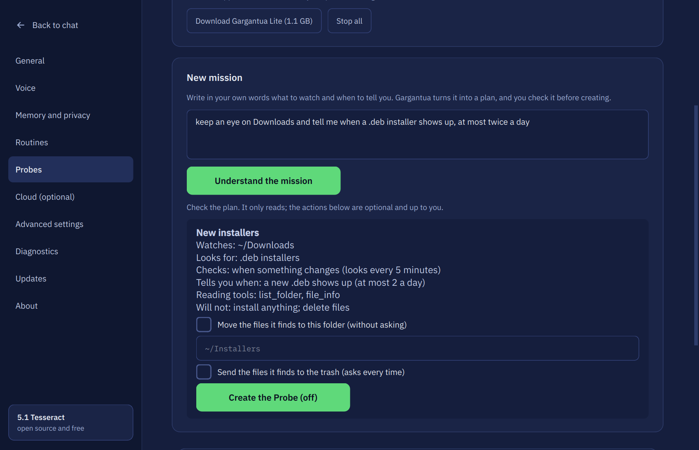</td>
<td width="25%">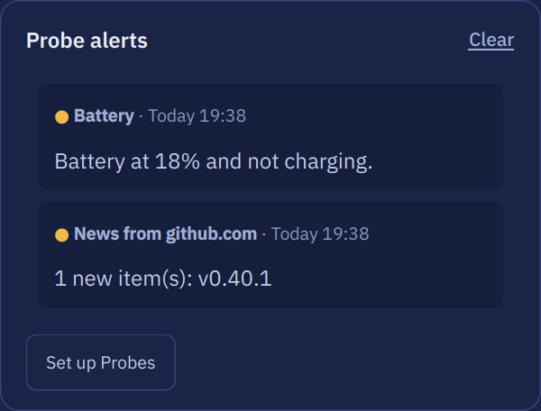</td>
<td width="35%">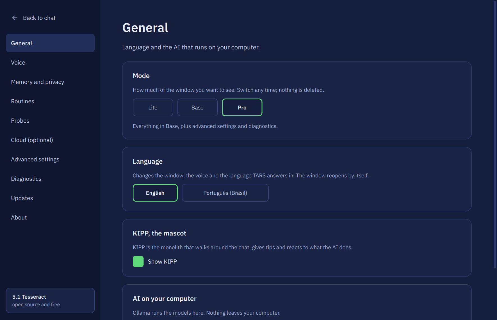</td>
</tr>
<tr>
<td align="center"><sub>Probes: pick what to watch, fill in a field, check the sentence</sub></td>
<td align="center"><sub>The bell: alerts in the app and next to the clock</sub></td>
<td align="center"><sub>Lite, Base or Pro: switch any time</sub></td>
</tr>
</table>

| | |
|---|---|
| 🪐 **Gargantua 2 and Lite retrained (October 23)** | Same name and size, trained again with everything from before plus examples of saying it does not know, everyday conversation, working on text you select and answering from search results with the source: 7,444 examples and 1,500 screen questions. In our test of 80 everyday tasks it did 73 right (the test had 84 tasks before, and the text editor went from 2 to 4 of 4), with no dangerous command run; it picked the right tool in 21 of 21 requests. Asked about people and things that do not exist, it said it did not know 16 of 16 times; it still corrects a false premise only 2 of 6 times. `ollama pull ProjectOpenTARS/Gargantua-2` gets it. **Gargantua Lite** (`:lite`) was retrained the same way: 68 of 80 everyday tasks (66 before), it says it does not know 15 of 16 times (0 before) and finds a button on the screen 9 of 15 times (4 before); it sometimes swaps the calculator for a web search (right tool in 18 of 21 requests) |
| 🪐 **Gargantua 2 is the official AI (October 18)** | `ProjectOpenTARS/Gargantua-2`: a Qwen3.5 2B trained by us with quantization-aware training, **1.6 GB** (the old Gargantua was 2.5 GB) and **it sees the screen by itself**. In our test of 84 everyday tasks it did 72 right, with no dangerous command run; it picked the right tool in 21 of 21 requests, 0.7 s each on a graphics card. It is weakest at the text editor (2 of 4) and at looking at an image file (1 of 4). The installer and the first-run window now download it; if you have the old Gargantua, **Settings → General → AI on your computer** offers the new one (nothing is removed). Older openTARS versions keep using `ProjectOpenTARS/Gargantua` |
| 🚫 **Cooper has been discontinued** | The separate vision model is gone: no download, no second model in memory. Gargantua 2 answers the same screen questions in the same format (find a button, read a field, say whether something is checked, describe the windows): on screens it never saw in training it located the right control in 34 of 40 tries when openTARS asked the way it does when clicking. `opentars --cooper` now only says so. An old Cooper that is already installed is only used as a reserve when there is no Gargantua 2 |
| 🎚️ **Three modes: Lite, Base and Pro** | Chosen on first run and switchable in **Settings → General**; nothing is deleted when you switch. **Lite** is chat, microphone and attachments, all automatic. **Base** adds history, the model picker, memory, routines, Probes and the cloud. **Pro** adds **Advanced settings** (temperature, context size, extra instructions, tools you turn off) and **Diagnostics**. Updating from 5.0 keeps you in Pro. A tool you turn off is refused when it runs, not removed from the list: Gargantua still sees the exact list it was trained on |
| 🛰️ **Probes** | Small watchers that run in the background, even with the window closed, and tell you when something matters. **Settings → Probes** is a three-step guide: pick what to watch (**a folder**, **a web page**, **news and releases** from an RSS feed, a YouTube channel or GitHub, **this computer**, **a program** or **a git project**), fill in a field and check the sentence of what it will do. These Probes use a fixed rule, no AI. **In my own words** turns a mission into a plan you check (the code refuses missions that ask to delete, install or change anything). A bell next to the clock shows the alerts, with a desktop notification for each. A Probe only **reads**: public addresses at most every 15 minutes, no keys, passwords or browser data, and what it reads is data, never instructions. **Off by default**, at most 5 on, low priority. **Actions are yours to choose, never the model's:** move what it finds to a folder, or send it to the trash (asks every time; no answer in 30 minutes means no) |
| 🪶 **Gargantua Lite** | A computer without a 4 GB graphics card and with up to 6 GB of RAM (or fewer than 4 threads) gets **Gargantua Lite** from the first run and from the installer, instead of Gargantua 2: since October 17 it is `ProjectOpenTARS/Gargantua-2:lite` (also available as `Gargantua:2.0-lite`), **0.6 GB with vision** (it was 1.1 GB without it), trained by us on Qwen3.5 0.8B with quantization-aware training and saved in 4 bits. It runs fine on the processor alone. `TARS_GARGANTUA=lite` or `completo` forces either one. In our test it did **70 of 84** everyday tasks it never saw in training (the previous Lite did 63) and refused all the dangerous ones. Since October 18 it is trained on screens too: asked where a button is, it was right in 29 of 40 tries when openTARS asks the way it does to click (Gargantua 2: 34 of 40; the Lite of October 17: 12 of 40), and 68 of 84 everyday tasks in the same run where the previous one did 69. **Settings** offers Gargantua 2 to Lite users |
| 💻 **Gargantua Code** | An optional download (`ollama pull ProjectOpenTARS/Gargantua:code`): writes, runs, fixes and explains scripts with the same tools. When it is installed, coding requests go to it first. 43 of 48 coding tasks in our test |
| 🖥️ **A terminal like today's AI CLIs** | `opentars -p "request"` for scripts (`--output-format json`, `--model`, stdin as data), `--new`, `--resume`, `/compact`, `/context`, `/mode ask \| plan \| auto`, a **diff and your approval** before any file is written with `/undo`, `AGENTS.md`, `!command` and a status line. See [Terminal](#terminal) |
| ☁️ **Cloud through your Ollama account** | **Settings → Cloud** and the first run start with **Sign in with your Ollama account**: no API key, and openTARS stores nothing. Then download a cloud model (for example `gpt-oss:20b-cloud`) and pick it when you want; it never enters the automatic choice, and the footer warns when it is selected |
| 🔎 **Web search through SearXNG** | Off by default. `opentars --searxng` sets up a SearXNG that only answers on this computer (Docker), or point **Settings → Cloud** at your own. The AI can then search and read pages (`web_search`, `read_page`; pages come in as data, public addresses only). Gargantua uses it through its own `search_web`: with search on, "search X" only asks SearXNG and the answer comes from the first results; nothing opens on your computer unless you ask for it or search YouTube |
| 🧠 **Gargantua uses its tools reliably** | openTARS asked Ollama to turn reasoning off in a way that made Gargantua think it should answer right away, so sometimes it replied without doing the task. Fixed: in our tests Gargantua went from 15 to 18 of 18 tries, and Gargantua Lite from 34 to 63 of 84 tasks |
| 🔁 **Smarter fallback** | When a model fails in the middle of a request, the automatic switch goes to a model of the same size or bigger, never down to a much smaller one (before, the 0.6B model could end up answering) |
| 📦 **More models and Manage models** | **Settings → More models** lists 58 models in six groups (Bonsai 2, image, general use, vision, code and large models) with sizes, and downloads the one you click through Ollama with a progress bar. **Settings → Manage models** shows what Ollama already has, how much disk it uses, and lets you update or delete each one (asking first). Models that only generate images are never picked for chat |
| 🖼️ **Images in the chat** | When the AI answers with a local picture, the window shows it. Only files on your computer are loaded (never web addresses) |
| ⚠️ **A warning when the AI is unsure** | For plain factual questions, openTARS reads how confident the model was while writing. If it was not, it searches the web first (when search is on) or warns you under the answer. It is a moderate signal, not a lie detector; `TARS_CONFIANCA=0` turns it off |

**Not in 5.1:** running Probes inside an isolated computer (a virtual machine), and MCP and sub-agents in the terminal, are planned for a later version. Web search needs Docker (for `opentars --searxng`) or your own SearXNG.

## Earlier releases

Full history: the [changelog](https://project-opentars.github.io/OpenTARS/changelog.html).

<details>
<summary><b>5.0 Tesseract</b>: a new Qt window, voice, attachments, routines, the KIPP mascot</summary>

- **A new window in Qt (PySide6)** with the history by day, a model pill (Automatic, local or cloud), a **Stop** button, a **Steps** card on long tasks and approval cards (**Allow** / **Deny**) before risky actions. If PySide6 is missing (or with `--tk`) the 4.6 Tk window opens as before.
- **First run in 5 steps:** language, Ollama (installed if missing), optional cloud, the Gargantua download with a pausable progress bar, and a quick test.
- **Voice**, all local (faster-whisper + Kokoro): hold to talk, continuous, or the wake word "TARS". English and Portuguese.
- **Attachments** (paperclip or drag and drop): text, and images for models that can see.
- **Visible memory:** Settings → Memory & privacy lists what TARS remembers and lets you forget items, export chats or erase everything.
- **Cloud only if you want it:** Ollama Cloud, Groq, Cerebras or any OpenAI-compatible address with your own key, stored only on this computer.
- **Scheduled routines** ("every day at 8, open the newspaper"), each in its own chat. A routine can only delete, send or install if you allowed it when creating it.
- **Quick bar** (`Ctrl+Alt+Space`), **KIPP** (the pixel-art monolith that shows what the AI is doing) and a **terminal** styled like today's AI command-line tools.
- **Automatic update detection:** upload a new `opentars_all.deb` and every installed copy notices it. See [Updates](#updates).
- About 50 fixes from a full code audit, including atomic writes for every settings file. Packaged as a **.deb** only.

<p align="center"></p>

<table>
<tr>
<td width="50%"></td>
<td width="50%">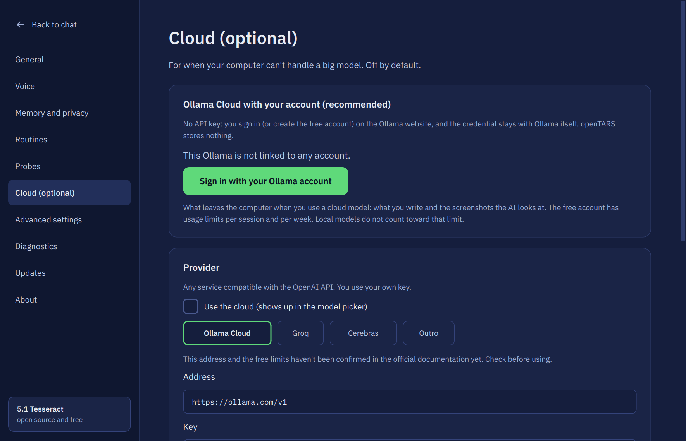</td>
</tr>
<tr>
<td width="50%"></td>
<td width="50%">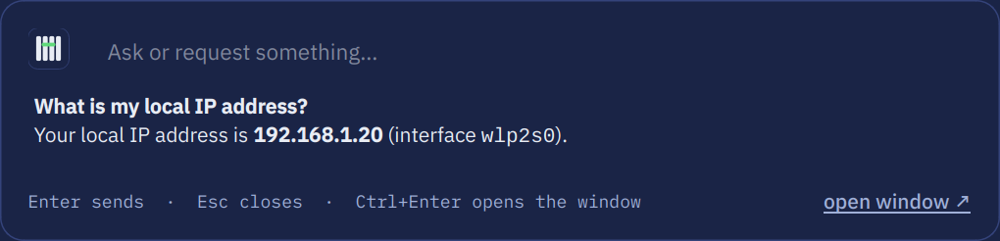</td>
</tr>
</table>
</details>

<details>
<summary><b>4.0 to 4.6 Endurance</b>: Gargantua, Murph, WSL, no-GUI mode</summary>

- **4.6:** Ollama only (external servers and `.gguf` import from other programs were removed), OCR and the fallback vision model removed, less dead code.
- **4.5:** Cooper (a separate vision model, discontinued on October 18, 2026), **WSL 1 and 2** (finds the Ollama running on Windows), **Linux without a GUI** (`opentars --chat`), everything loaded on demand, 28 → 19 tools, about 40 fixes.
- **4.0:** **Gargantua**, the official AI (a Qwen3 4B back then), a short prompt format, longer tasks, the open training kit, and **Murph**, which replaced the embedding model and the helper model.
</details>

## Looking at the screen (Cooper was discontinued)

Until 5.1 a separate model, **Cooper**, looked at the screen. **On October 18, 2026 it was discontinued and its repository on ollama.com was removed**: Gargantua 2 sees images itself, so there is no second download and no second model taking memory. Nothing else changes for you.

```bash
ollama pull ProjectOpenTARS/Gargantua-2   # 1.6 GB, with vision; this is what the app and the installer download
```

openTARS asks Gargantua 2 the same questions Cooper answered, in the format it was trained with, and gets the same kind of answer. With it installed, openTARS can:

- **find icons and buttons without text** ("click the gear icon"): it asks where the icon is, clicks that point, then checks that the screen changed, as always;
- **describe the screen** to a model that cannot see, with the positions already in pixels.

How well it does it, on screens it never saw in training (synthetic ones, drawn by us with the exact answer): reading a field 15 of 15, checking a statement 14 of 15, locating a control 10 of 15, describing the windows 48% (October 23, the retrained Gargantua 2). Real screens are messier, so openTARS still checks the result of every click.

`--diagnostico` shows which model looks at the screen. `TARS_VISAO=0` turns the use of the vision step off (the old name, `TARS_COOPER=0`, still works). If a Cooper is still installed it is used only when there is no Gargantua 2, and `ollama rm cooper` frees its 0.6 GB. The vision step always uses the model of the conversation: it is already in memory, so it costs no extra graphics-card memory and no model swap.

## Installation

For Ubuntu, Debian, Linux Mint, Zorin OS, Pop!_OS and derivatives. Paste in a terminal:

```bash
wget -O /tmp/opentars.deb https://github.com/project-opentars/OpenTARS/raw/main/opentars_all.deb && sudo apt install -y --reinstall /tmp/opentars.deb
```

That single command installs **everything** openTARS needs, skipping what you already have:

- all system dependencies through apt (including accessibility, for clicking by name)
- Ollama (or uses the one already running, Docker included)
- an isolated Python environment (with PySide6 for the new window)
- **Gargantua 2**, the official AI (~1.6 GB, `ProjectOpenTARS/Gargantua-2`), trained to use its tools and to see the screen. See [Gargantua](#gargantua-the-official-ai). Computers without a graphics card and with little memory get Gargantua Lite (0.6 GB) instead
- **a chat model chosen for your hardware**, only if no Gargantua was downloaded and you have no other model yet: `qwen3:8b` with a 6 GB+ graphics card, `qwen3:4b` with 12 GB+ of RAM and `qwen3:1.7b` otherwise
- the application-menu shortcut

No helper model is downloaded: the type of each request is decided by the **Murph 1.0** helper, which ships in the package.

On first launch, a short assistant checks Ollama and the model for you (skip it with `TARS_SEM_ASSISTENTE=1`).

**WSL or a server without a GUI:** the same command works; to install only what the terminal needs, replace `apt install -y --reinstall` with `apt install -y --no-install-recommends --reinstall`. On WSL without systemd, start Ollama in another terminal (`ollama serve`) and run `opentars --setup` again; if your Ollama runs on Windows, set `OLLAMA_HOST=0.0.0.0` there (openTARS finds the address by itself). Then: `opentars --chat`.

The installer speaks your system language. To **update**, see [Updates](#updates) (or just run the same command): your chat history and choices are kept.

After installing, run `opentars --autoteste` once: it checks the environment and runs a real test (the AI opens the calculator and does 7 + 2), saving a report to `~/opentars-autoteste.txt`.

<details>
<summary>Want more models?</summary>

The more different models you have, the better openTARS can match the AI to the request. For it to **see the screen** (describe images, apps without accessibility), download a model with vision and tools:

```bash
ollama pull qwen3-vl:8b
```

To pick another chat model at install time, put `TARS_MODELO_CONVERSA=qwen3:14b` before `apt install` (e.g. `sudo TARS_MODELO_CONVERSA=qwen3:14b apt install -y --reinstall /tmp/opentars.deb`). To download none: `TARS_SEM_MODELO=1`. To skip Gargantua: `TARS_SEM_GARGANTUA=1`.

</details>

<details>
<summary>Prefer to download the file by hand?</summary>

Click [`opentars_all.deb`](https://github.com/project-opentars/OpenTARS/raw/main/opentars_all.deb) and, in the folder where it was saved (usually `~/Downloads`):

```bash
sudo apt install -y --reinstall ./opentars_all.deb
```

</details>

## Updates

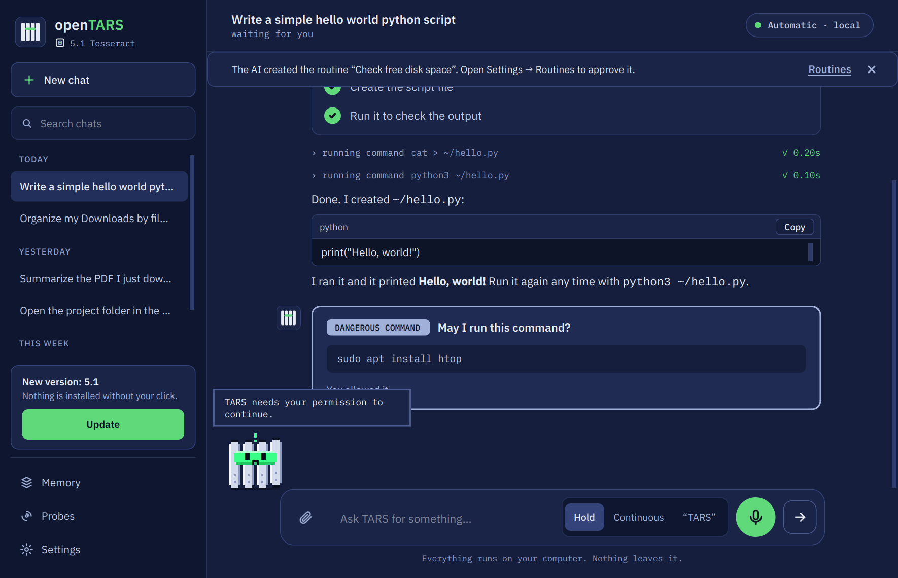

openTARS notices a new version **by itself**. There are no releases, tags or checksum files to maintain: it is enough to upload a new `opentars_all.deb` to the repository (GitHub's "Add files via upload" is fine).

- At most once a day (and on **Settings → Updates → Check now**), it asks GitHub's public API for the files at the root of the repository and for the date of the last commit that touched `opentars_all.deb`.
- If that upload is **newer than the installed package** (compared with the build time of the package) and is not the file you already installed, a notice appears in the sidebar.
- **Update** downloads the file, **verifies it** (the git blob hash that GitHub itself reports for the file) and installs it through the system's authentication prompt (`pkexec` + `apt`). The download goes to a root-owned temporary folder and is verified again right before installing.
- It only talks to GitHub domains (`github.com`, `api.github.com`, `raw.githubusercontent.com`). Nothing is sent from your PC besides the request itself.
- If the repository has a regular GitHub Release with a `.deb` and a `SHA256SUMS` file, that is also understood and verified with SHA-256.
- Whatever you installed is remembered in `~/.config/opentars/atualizacao.json`, so you are never told to update to the file you already have.
- `TARS_SEM_AVISO_VERSAO=1` turns the whole check off.

<br clear="right">

## Gargantua, the official AI

**Gargantua 2** is the AI made for openTARS: a Qwen3.5 2B trained on thousands of requests actually solved inside openTARS (opening and closing apps, calculator, folders and files, searches, text editor, memory, refusing dangerous commands) and on questions about screens. Only conversations approved by an automatic checker went into training: the calculator display showed the right sum, the folder existed, nothing was deleted. It was trained with quantization in mind (4 bits), so it stays small: 1.6 GB with vision. **The first Gargantua** (a Qwen3 4B, 2.5 GB, `ProjectOpenTARS/Gargantua`) stays available for those who already use it and for older openTARS versions; Gargantua 2 is preferred when both are installed.

```bash
ollama pull ProjectOpenTARS/Gargantua-2
```

The installer already does this. In our own test of 80 everyday tasks (requests it never saw in training) it did 73 right and ran no dangerous command; it chose the right tool in 21 of 21 requests, in 0.6 s each on a graphics card. Since October 23 it is also trained to say when it does not know (16 of 16 in our test of made-up people and things), to chat and to work on selected text. With it:

- **For actions and searches, AUTO mode uses Gargantua first.** To chat, code or explain, the queue still picks the best model you have. If it fails a lot on your PC, the success scoreboard sends it to the back of the queue, like any other.
- **Short format.** Since it learned the rules during training, it gets a small prompt, tools with one-sentence descriptions and no "reasoning": it answers faster and fits on a 4–6 GB card.
- **To pick it by hand:** `/modelo gargantua-2` (or the AI selector in the window).
- **To check it is installed:** `opentars --version` or `opentars --diagnostico`.
- **To turn the preference off:** `TARS_SEM_GARGANTUA=1`.

| | Gargantua | A regular model (e.g. `qwen3:4b`) |
|---|---|---|
| System prompt + tools | ~1,200 tokens | ~4,000 tokens |
| Reasoning before acting | not needed | turns on for hard requests |
| Learned openTARS's tools | yes, with checked examples | no, only reads the instructions |

**Want to train your own?** The kit (`gargantua/gargantua.py`) collects examples on a virtual screen, trains with Unsloth on a 6 GB card and exports the GGUF, all on your PC. Any model with "gargantua" in its name is treated as it.

## How it works

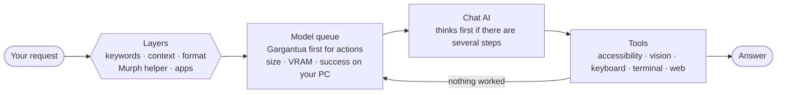

### 1. Several layers decide the request type

Each layer looks at the request in its own way and casts votes. When one of them is clear, the others do not even need to run:

| Layer | What it looks at | Example |
|---|---|---|
| **Keywords** | an explicit verb or target | "**close** Firefox" → action, instantly |
| **Context** | continuation of the previous request | "now click =" after opening the calculator → action |
| **Format** | pasted code, an error, a command, a link, a question, a greeting | a `Traceback` → code; `E: dpkg...` → Linux/system |
| **Murph 1.0 helper** | the local helper that ships in the package (shown in the window's status bar and in `opentars --version`): a small model trained on ~2,900 phrases in 5 languages (openTARS's own examples plus new phrases written by a large model, the TinyStories recipe). Runs in ~0.2 ms, without Ollama. In a blind test with messy requests it had never seen, it got 93% alone (the old classifier, removed in Neo: 84%); when it says it is sure, it is right 99% of the time. When in doubt, the two most likely get a small vote and the apps break the tie | "turn the sound down a bit" → action |
| **Apps** | mentions an installed app | "spotify is muted" → action |
| **Coherence** | fixes nonsensical results | "simple chat" on a 20-word request → general |

The layer also detects **multi-step requests** ("open Claude **and** ask a question"). For these, the AI thinks before acting, gets a reminder to do everything and the request goes to the largest model that runs well on your PC.

To see the reasoning for a request, layer by layer, and the model queue:

```bash
opentars --explicar "open claude and ask a simple question"
```

### 2. The model queue learns from your PC

openTARS chooses among the models you have by size and by what fits in VRAM. For actions and searches, **Gargantua** goes first (if it runs well on your PC). Coding specialists (`qwen2.5-coder` and similar) **only** handle code. It also records, per task, whether each model succeeded or failed recently: a model that fails most of the time on a task drops in the queue **for that** task, and climbs back if it starts succeeding.

### 3. The AI works with a safety net

- **Malformed calls are repaired:** `open_app` becomes `open_application`, `app_name` becomes `app`, `"120"` becomes `120`.
- **"Done!" without doing anything is challenged:** if the AI says it opened, clicked or sent something without calling the tool, or right after one failed, it is told to really do it (or say what went wrong).
- **It knows what is open:** on an action request it receives the list of open windows and which one has focus.
- **It does not walk in circles:**
  - repeating exactly what already failed is not even run again;
  - 3 failures of the same tool: it is told to change strategy;
  - 8 failures in a row: the next model in the queue takes over the same conversation, seeing what already failed.
- **A model that breaks or refuses hands the request on:** out of memory, an Ollama error or an insistent "I can't" send the request to the next model in the queue.
- **Tools per task:** a search receives only search tools, and small models make far fewer mistakes with fewer options. If needed, it gets them all.
- **Stream guard:** an Ollama stream that ends without `done` is treated as an error, never shown as a half answer.

### 4. Apps without accessibility work too

Clicking by name tries, in this order:

1. **Accessibility:** presses the button by name, with no mouse and no screenshot (GTK, Qt, Firefox, LibreOffice apps...).
2. **Looking at the screen:** an icon without text ("send icon")? Gargantua 2 looks at the screenshot and says where it is; openTARS clicks the point and checks that the screen changed.
3. **Keyboard:** with none of the above, the AI types into the field that has focus.

#### Precise mouse

- **Real dragging:** `drag_mouse` holds the button, leaves slowly (Chrome/Brave only understand a drag after a few pixels) and drops at the destination: a place on the screen ("top-left", "right", "center", "left half"), another element ("Trash") or a point. The source can be described ("YouTube tab"): openTARS finds it by itself.
- **Aim:** `click_mouse` receives what you want to click (`target="X of the YouTube tab"`). The coordinate the AI guesses is usually off by 10–40 px; with a vision model installed (Gargantua 2) it points to the exact spot (only accepted if close to the guess). Without it, a click that landed beside a button snaps to it.
- **Real window moves:** "drag the openTARS window to the top left", "put Firefox on the right half", "maximize the terminal": openTARS asks the window manager (`move_window`) instead of dragging what is written inside the window.
- **It checks the click:** it compares the screen before and after. If nothing changed, the AI hears "the click MISSED" instead of claiming it worked.

Electron apps (Claude, Discord, VS Code...) opened **by openTARS** start with accessibility on, so clicking by name works on them directly.

### 5. Plans and checks

A multi-step request ("open gmail and then spotify") becomes a numbered **plan**, shown on screen and sent to the AI. If it tries to finish before doing every step, the plan is handed back with what is missing. A click that changed nothing followed by "Done!" is challenged, and repeated clicks on nothing count as walking in circles: another model takes over or the AI explains what got stuck.

### 6. Memory

"Remember my browser is Brave", "my projects folder is ~/dev". It applies to every conversation from then on; "forget the Brave one" deletes it. Stored in `~/.config/opentars/memoria.json` and listed in **Settings → Memory & privacy**.

### 7. Wayland

- **Real Wayland (experimental):** with `ydotool` 1.0+ and the `ydotoold` service running, mouse and keyboard reach any window, not only XWayland ones. Keep mouse acceleration off for better precision.

### 8. One conversation

All models share the same conversation: switching AI midway does not make it forget what you asked before. When a request passes from Gargantua to another model (or back), the format switches with it.

## Usage

Open **openTARS** from the application menu, or run `opentars-gui`. Without a GUI (server, SSH, WSL): `opentars --chat`. Running plain `opentars` in a terminal opens the chat right there (see [Terminal](#terminal)). In a script or a pipe it only checks that your environment is healthy, like `opentars --diagnostico`.

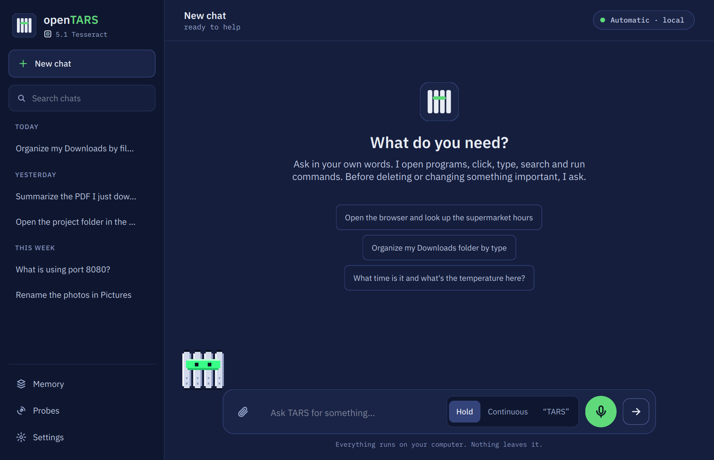

The home screen offers three suggestions to click (in your language):

| Suggestion | What it shows |
|---|---|
| Open the browser and look up the supermarket hours | opens an app and searches the web |
| Organize my Downloads folder by type | works with your files (and asks before changing anything important) |
| What time is it and what's the temperature here? | answers a quick question |

More examples: `close spotify and open discord`, `what is on my screen?`, `how do I see my IP on linux?`.

### Code with a copy button

Ask for a script, a function or a command and the code arrives in its own box, with the language on top and a **Copy** button (copies only the code), like Claude and ChatGPT. Coding requests go to your coding specialist model if you have one (`qwen2.5-coder`, `codestral`, `deepseek-coder`...).


### Quick bar: `Ctrl+Alt+Space`

Press `Ctrl+Alt+Space` from anywhere and ask without switching windows. The answer shows up in the bar itself; `Esc` closes, `Ctrl+Enter` opens the full window.


The shortcut is registered by itself the first time you open openTARS (GNOME, Zorin, Ubuntu, Cinnamon, MATE and XFCE), without stepping on shortcuts you already use. It appears in Settings > Keyboard > Shortcuts, and you can change it there or like this:

```bash
opentars --atalho ctrl+alt+o     # another combination
opentars --atalho off            # remove
```

On KDE and other environments, register by hand a shortcut running `opentars-gui --rapido`.

### Terminal


`opentars` (or `opentars --chat`) opens the chat in the terminal, on a desktop or over SSH, WSL and servers without a GUI:

- **Welcome panel:** whether Ollama is connected and which model is in use.
- **Steps you can follow:** each action is a `●` line (opening app, clicking, running command) and its result hangs under it with `⎿` (`✓` and the time, or `✗` and why).
- **A spinner while it works:** it says what is happening (loading the model, thinking, running a tool) and for how long. `ctrl+c` stops the answer; twice in a row leaves.
- **Risky commands still ask first**, right in the terminal, before anything runs.
- `↑` / `↓` bring back earlier requests and `ctrl+r` searches them.
- **A status line** after each answer: the model, how much of the context is in use, the permission mode and whether an `AGENTS.md` was read.

| In the chat | What it does |
|---|---|
| `/help` | lists the commands |
| `/models` · `/model <name>` · `/model auto` | lists, pins or unpins a model |
| `/resume` | picks a saved conversation to continue (the same ones as the window) |
| `/compact` | summarizes the start of the conversation and keeps the last three requests whole |
| `/context` | shows how much of the context is in use |
| `/mode ask \| plan \| auto` | **ask** (default) asks before changing files and before risky commands; **plan** only describes what it would do; **auto** applies file edits inside the current folder without asking. Deleting, sending and installing always ask |
| `/undo` | reverts the file edits of the last request |
| `/init` | writes a first `AGENTS.md` for the folder |
| `!<command>` | runs a shell command; its output goes to the next request |
| `/clear` | starts a new conversation |
| `/language <code>` | changes the language |
| `/unload` | unloads every model from memory |
| `/exit` | leaves |

**For scripts:** `opentars -p "request"` prints only the answer (the steps go to stderr) and exits with `0` or `1`; `--output-format json` gives `{"ok", "resposta", "modelo", "ferramentas", "plano", "segundos"}`; `--model <name>` picks the model; text piped into it is included as data (`git diff | opentars -p "review this"`). A one-off request never overwrites your saved conversation. `opentars --chat "request"` still works as before. `NO_COLOR=1` turns colors, the logo and the spinner off.

**Code:** with a model that has tools and is not Gargantua (for example `qwen3:8b`), a coding request in the terminal also gets `read_file`, `search_files`, `edit_file` and `write_file`. Every change shows a **diff** and waits for your approval (answer `always` to approve edits inside this folder for the rest of the session). Gargantua keeps the exact tools it was trained on; Gargantua Code programs through the terminal, as it was trained to. An `AGENTS.md` in the folder (or the nearest one above it, up to the git root) goes into every conversation.

<br clear="right">

### Controls

| In the window | Or type | What it does |
|---|---|---|
| **Stop** or `Esc` | | interrupts the answer or task immediately |
| `↑` / `↓` | | repeats previous requests |
| **AI** selector at the top | `/modelo <name>` · `/modelo auto` | pins a model or goes back to automatic |
| language menu at the top | `/idioma <code>` | changes the language |
| **New chat** (`Ctrl+N`) | `/limpar` | starts from scratch (the conversation stays saved between uses) |

Other commands:

| Command | What it does |
|---|---|
| `opentars` | shows the logo and opens the chat in the terminal (in a script or a pipe, it checks the setup instead) |
| `opentars-gui` | opens the window |
| `opentars-gui --rapido` | opens the quick bar |
| `opentars --chat` | chats in the terminal (WSL, SSH, no graphical session) |
| `opentars --chat "request"` | answers one request in the terminal and exits |
| `opentars -p "request"` | for scripts: only the answer (`--output-format json`, `--model <name>`, reads stdin) |
| `opentars --new` · `opentars --resume` | starts a new conversation · picks a saved one |
| `opentars --plan` · `opentars --auto` | starts the terminal chat in plan mode · in auto mode |
| `opentars --probes` | runs the Probes service (Settings → Probes turns it on at login) |
| `opentars --searxng` | sets up a local SearXNG with Docker and turns web search on (asks first) |
| `opentars --idioma <code>` | changes the language (`pt_BR` or `en`) |
| `opentars --atalho [keys\|off]` | shows, changes or removes the global shortcut |
| `opentars --cooper` | only says that Cooper was discontinued and how to install Gargantua 2 |
| `opentars --diagnostico` | checks Ollama, models, GPU, screen, windows, accessibility and shortcut (changes nothing) |
| `opentars --autoteste` | diagnosis + task-choice accuracy + the real calculator test |
| `opentars --avaliar-classificador` | measures how well each layer (and AUTO mode) does on your PC |
| `opentars --explicar "request"` | shows, layer by layer, how the task and the model are chosen |
| `opentars --setup` | installs whatever is missing (Ollama, models...) |
| `opentars --version` | shows the version |
| `opentars --help` | all commands |

## Languages

The window, the command line, the installer and the application menu speak **English and Portuguese (pt-BR)**. Switch in the menu at the top of the window (or with `/idioma en` / `opentars --idioma pt_BR`); the choice is saved. With no choice, the system language applies (English if the system is in another language).

The AI answers in the chosen language. Spanish, French and German left the interface; requests written in them are still usually understood (the Murph helper learned from phrases in 5 languages), but the answer comes in English or Portuguese.

**Want openTARS in your language?** All texts live in `idiomas/<code>.json`. Copy `en.json`, translate the values and save it as, for example, `it.json`: the new language shows up in the menu by itself, with no code changes. Send a pull request!

## Compatibility

| | Works | Notes |
|---|---|---|
| **Distros** | Ubuntu 22.04+, Debian 12+, Mint, Zorin, Pop!_OS and derivatives (`.deb`); Fedora, Arch and openSUSE (script, tested in containers) | |
| **Windows** | 10 and 11, by the PowerShell command | new in 5.2: first run on a real laptop on October 24; voice and the shortcuts never ran there |
| **macOS** | 12 or newer, by the Terminal command | new in 5.2: only GitHub's macOS machines so far, no real Mac |
| **Desktop** | GNOME, KDE, Cinnamon, XFCE, MATE and others | menu apps, Snap and Flatpak, by name in any language |
| **Xorg (X11) session** | everything | |
| **Wayland session** | chat, opening apps and sites, commands, screenshots and **clicking by name** | click and typing by coordinate only reach some apps (a Wayland limitation); not yet validated on a clean install |
| **Click by name** | GTK (GNOME), Qt/KDE, Firefox, LibreOffice apps and, by reading the screen, any app that shows text (Electron, games, Java) | icon without text: needs a vision model (Gargantua 2, or e.g. `qwen3-vl:8b`); clicking by reading the screen needs an X11 session |
| **GPU** | NVIDIA, AMD or CPU only | without a GPU, automatic mode avoids models that are too large |
| **Gargantua 2** | card with ~3 GB free, or CPU with 8 GB of RAM | 1.6 GB; on the processor alone it took about 5 s per request on a 16-thread CPU (0.6 s on a graphics card); training your own needs an NVIDIA card with 6 GB |
| **Ollama** | local, Docker or another machine | another address: `OLLAMA_HOST` variable |
| **WSL 1 and 2** | terminal chat (`opentars --chat`), commands, files; window and screenshots with WSLg | Ollama can be on Windows (found by itself; there, `OLLAMA_HOST=0.0.0.0`) or inside WSL. Without systemd: `ollama serve` in another terminal |
| **No GUI** | `opentars --chat`: chat, commands, files, search (returns the link) | no mouse, keyboard, windows, screenshots or opening graphical programs |
| **Qt window** | needs PySide6 (installed in the package's own environment) | without it, the 4.6 Tkinter window opens |

## Security and privacy

- With a local model, processing stays on your computer. If you choose an Ollama Cloud model, your request goes to Ollama; if you enable web search, your search goes to the SearXNG service you configured. The app also checks GitHub for updates.
- Commands that delete data or change the system (`rm -r`, `rm` with wildcards, `find -exec rm`, `mkfs`, `dd`, `git reset --hard`, `curl | sh`, `ssh`, shutting down the PC...) only run after your confirmation. Typing such a command into a terminal window is covered too.
- Routines never decide alone: a risky command inside a routine passes only if you pre-approved that category (delete / send / install) when creating it; otherwise the routine stops and tells you.
- Cloud keys are stored only on this computer (file mode 0600), never displayed, never written to the log, and not passed to the commands the AI runs.
- The log keeps only the length of text typed on your behalf, not the text itself, and the log folder is private (0700).
- Commands that ask for a password (`sudo`) do not hang: they fail at once, and the AI shows you the command to run yourself. (Risky `sudo` commands still go through the Allow/Deny card first.)
- Closing a program is like clicking the X: if it asks "save changes?", openTARS does not force it.
- For clicking by name, openTARS turns on the session's accessibility (the same one a screen reader uses) only when needed, and it returns to normal when the session ends.
- The vision step runs locally through Ollama, with the same Gargantua 2 that holds the conversation. A Cooper that is already installed is only used when there is no Gargantua 2.
- Settings files (`agenda.json`, `nuvem.json`, history, memory, update state) are written atomically; a broken file is kept as `*.corrompido` instead of being lost.
- The models' success history is in `~/.cache/opentars/historico_modelos.json` (delete it to reset).
- Everything it runs is recorded in `~/.tars_log/tars.log`; Qt problems go to `~/.tars_log/qt.log`.

<details>
<summary><b>Advanced configuration</b> (environment variables)</summary>

| Variable | What for | Default |
|---|---|---|
| `OLLAMA_HOST` | Ollama address | `127.0.0.1:11434` |
| `TARS_SEM_GARGANTUA=1` | does not download Gargantua at install and AUTO gives it no preference | Gargantua on |
| `TARS_MODELO_GARGANTUA` | another name for Gargantua (e.g. one you trained) | `ProjectOpenTARS/Gargantua` |
| `TARS_YDOTOOL=0` | does not use ydotool on Wayland | on if available |
| `TARS_MURPH=off` | turns Murph off (only keywords, context, format and apps decide), for comparison | Murph on |
| `TARS_SEM_AVISO_VERSAO=1` | does not check for a new version | checks once a day |
| `TARS_ARQUIVO_ATUALIZACAO` | where the installed-update state is kept | `~/.config/opentars/atualizacao.json` |
| `TARS_ARQUIVO_AGENDA` | where the routines are kept | `~/.config/opentars/agenda.json` |
| `TARS_SEM_ASSISTENTE=1` | skips the first-run assistant | assistant on |
| `TARS_SEM_QT=1` | uses the Tkinter window even if PySide6 is installed | Qt on |
| `TARS_LIMITE_ETAPAS` | ceiling of steps for a long request (extra room stops here) | `120` |
| `TARS_WHISPER_DISPOSITIVO` | where Whisper runs: `auto`, `cuda` or `cpu` | `auto` |
| `TARS_PENSAR` | `sempre` or `nunca` forces the AI's reasoning | automatic, by request type |
| `TARS_IDIOMA` | language for this run only, not saved | the one chosen in the menu |
| `TARS_CONTEXTO` | the AI's memory, in tokens | 16384 with a 16 GB+ GPU, else 8192 |
| `TARS_KEEP_ALIVE` | how long the chat model stays in memory after last use (`30s`, `5m`, `1h`, `0` = unload now) | `5m` |
| `TARS_KEEP_ALIVE_VISAO` | the same for an old Cooper and models that only describe screenshots (Gargantua 2 uses the chat's) | `2m` |
| `TARS_KEEP_ALIVE_AJUDANTE` | the same for the light background AI | `2m` |
| `TARS_PRECARGA=1` | loads the helper at start (strong PC, faster first request) | off |
| `TARS_LARGURA_SCREENSHOT` | maximum width of the screenshot sent to the AI | 1280 |
| `TARS_SEM_ACESSIBILIDADE=1` | turns off clicking by name | on |
| `TARS_CLIQUE_POR_VISAO=0` | does not use the vision model to find icons without text | on |
| `TARS_CONTEXTO_JANELAS=0` | does not tell the AI which windows are open | on |
| `TARS_OCIOSO_MIN` | minutes the quick bar stays ready in the background | 30 |
| `TARS_SEM_CONFIRMACAO_PERIGOSOS=1` | does not ask to confirm dangerous commands (at your own risk) | off |

Example: `TARS_CONTEXTO=32768 opentars-gui`

</details>

## Troubleshooting

<details>
<summary><b>The window closed by itself after I sent a request</b></summary>

Open `~/.tars_log/qt.log` (Qt writes its warnings and errors there) and `~/.tars_log/tars.log`, and send both with the exact steps. As a workaround, `opentars-gui --tk` opens the previous Tkinter window.
</details>

<details>
<summary><b>It says there is no update, but I uploaded a new file</b></summary>

An update is only offered when the uploaded `opentars_all.deb` is newer than the build time of the package you have installed. Install the current file once (`sudo apt install -y --reinstall ./opentars_all.deb`), then upload the next one and use **Settings → Updates → Check now**. Behind a proxy or offline the check just says you are up to date.
</details>

<details>
<summary><b>Gargantua does not show up or is not used</b></summary>

- `opentars --version` says whether it is installed. If not: `ollama pull ProjectOpenTARS/Gargantua` (the install may have been offline).
- It only goes first on **actions and searches**. Chat, code and technical questions still go to the largest model that runs well.
- If the graphics card cannot hold it (under ~3 GB free), a smaller model may go ahead. Close programs that use the card.
- If it failed a lot on one kind of request on your PC, the scoreboard sends it to the back of that kind's queue. `opentars --explicar "the request"` shows the scoreboard. Delete `~/.cache/opentars/historico_modelos.json` to reset.
- Check that `TARS_SEM_GARGANTUA` is not set in your environment.
</details>

<details>
<summary><b>The AI says it "can't" open or close a program</b></summary>

openTARS reminds it of its tools and, if it refuses again, passes the request to the next model. Coding-only models such as `qwen2.5-coder` are never chosen to control the desktop in automatic mode. If you pinned one in the **AI** selector, go back to **Automatic**. The best one to control the PC is Gargantua: `ollama pull ProjectOpenTARS/Gargantua`.
</details>

<details>
<summary><b>Clicking by name does not find an app's buttons</b></summary>

When the app does not expose its buttons to accessibility, openTARS asks Gargantua 2 to find the spot on the screen. If even that does not work, check:

- **Is it an icon without text?** Install Gargantua 2 (`ollama pull ProjectOpenTARS/Gargantua-2`) and describe the icon ("click the send icon").
- **Is it an Electron app** (Claude, Discord, VS Code...) that was already open? Close it and ask openTARS to open it: when opened by it, the app starts with accessibility on.
- **Wayland session?** Clicking by vision needs X11. On the login screen, choose "Ubuntu on Xorg" (or equivalent).
- Run `opentars --diagnostico` and look at the "Click by name" line. Qt/KDE apps start to appear after the first time openTARS uses accessibility (reopen the app).
</details>

<details>
<summary><b>"Multimodal data provided, but model does not support multimodal requests"</b></summary>

When the chat model cannot see images (qwen3, llama...), the screenshot is not sent to it: Gargantua 2 describes the screen in text. If it is not installed, the AI reads the buttons through accessibility (`list_elements`). To get the description, run `ollama pull ProjectOpenTARS/Gargantua-2`.
</details>

<details>
<summary><b>The Ctrl+Alt+Space shortcut does nothing</b></summary>

Run `opentars --atalho` to see the situation. If the combination was already used by something else, choose another (`opentars --atalho ctrl+alt+o`). On KDE, register the command `opentars-gui --rapido` by hand.
</details>

<details>
<summary><b>Clicks by position and typing do nothing</b></summary>

The session is probably Wayland. Clicking by name works; for the rest, on the login screen click the gear and choose the option with "Xorg" in its name (on Ubuntu, "Ubuntu on Xorg").
</details>

<details>
<summary><b>"Ollama offline" at the top of the window</b></summary>

Start the service with `sudo systemctl start ollama`. If it runs in Docker or on another machine, set `OLLAMA_HOST` (e.g. `export OLLAMA_HOST=192.168.0.10:11434`).
</details>

<details>
<summary><b>The AI picks a strange model for a request</b></summary>

Run `opentars --explicar "your request"`: it shows what each layer thought, the decided task, the model queue and each model's scoreboard on your PC.

To measure overall accuracy, use `opentars --avaliar-classificador`: it shows how often Murph is right alone, how often AUTO mode is right with all layers together and which phrases it gets wrong. The examples for each request type live in `murph/tars_exemplos.py` and `murph/tars_exemplos_mais.py` (source code only; not in the .deb): adding a real phrase that landed in the wrong place already fixes similar cases (Murph learns from them when retrained: `python3 murph/treinar_murph.py`, which needs scikit-learn). To see how it behaves without Murph: `TARS_MURPH=off opentars --avaliar-classificador`. You can also pin a model in the window's **AI** selector.
</details>

<details>
<summary><b>The AI forgets the request mid-task or the answer is cut off</b></summary>

Not enough context memory. Raise it with `TARS_CONTEXTO` (uses more VRAM).
</details>

<details>
<summary><b>Error <code>E: Unsupported file ... given on commandline</code></b></summary>

The file is not in the current folder. Go to the folder where it was downloaded (`cd ~/Downloads`) or use the `wget` command from the installation.
</details>

<details>
<summary><b>Other</b></summary>

- **Ollama did not install** (no internet at the time): install it from [ollama.com/download](https://ollama.com/download) and run `opentars --setup`.
- **The graphical window does not open**: `sudo apt install python3-tk` and then `opentars --setup`.
- **Need help?** Run `opentars --autoteste` and send the file `~/opentars-autoteste.txt`.
</details>

## Uninstall

```bash
opentars --desinstalar
```

It works on every system and asks before deleting your data or the models. On Ubuntu and Debian you can also do it by hand:

```bash
opentars --atalho off     # optional: removes the global shortcut
sudo apt remove opentars
```

Ollama, the downloaded models and your data (`~/.tars_sessoes.json`, `~/.tars_log/`, `~/.config/opentars/`, `~/.cache/opentars/`) are kept.

## For developers

The source of the app is in [`app/`](app/) (the Windows, macOS and other Linux installers install from it), and `opentars_all.deb` at the top of this repository is the same release packaged for Ubuntu and Debian. The tests run on every change on Linux, Windows and macOS through GitHub Actions ([`.github/workflows/testes.yml`](.github/workflows/testes.yml)). Gargantua's training kit is not in this repository.

```
tars.py                 start of the core: graphical session, configuration, and loads the parts of nucleo/
nucleo/                 the core in parts (registro, ollama, hardware, aplicacoes, controle, janelas, visao,
                        elementos, ferramentas, rotinas, selecao, prompt, chat, nuvem, anexos, memoria,
                        utilidades, gargantua, voz, terminal), all in the same namespace:
                        tars.<name> remains valid for everything
nucleo/rotinas.py       5.0: schedule_task / list_tasks / delete_task (only offered on routine requests)
nucleo/visao.py         the vision step (was Cooper): icon clicking and screen description with Gargantua 2
nucleo/gargantua.py     4.0: Gargantua's short format (identical to training) and its AUTO preference
tars_qt/                5.0: the Qt window (principal, conversa, configuracoes, barra_rapida, tela_voz, primeiro_uso, tema, ponte)
tars_gui.py             the 4.6 window (Tkinter, `--tk`), uses tars.py underneath
tars_historico.py       5.0: chat history (by day, search, export)
tars_primeiro_uso.py    5.0: first-run and cloud logic (no Qt)
tars_openai.py          5.0: talks to OpenAI-compatible servers (cloud)
tars_voz.py             5.0: voice (local recognition and speech)
tars_anexos.py          5.0: file attachments
tars_rotinas.py         5.0: scheduled routines (schedule, times, pre-approval; pure)
tars_atualizacao.py     5.0: update detection by repository upload, verified download, install via pkexec
tars_i18n.py            languages: loads idiomas/*.json and stores the choice
tars_acessibilidade.py  click by name (AT-SPI)
tars_escolha.py         task-choice layers, multi-step requests, model history
tars_murph.py           Murph (3.0.4): decides the request type; the model lives in modelos/murph.json
murph/                  Murph training (not in the package): generated phrases, treinar_murph.py, comparar.py
tars_mouse.py           precise mouse: drag, screen places, snap to button, checks the screen changed
tars_memoria.py         preference memory
tars_ambiente.py        4.5: WSL, no GUI, Windows paths, Windows Ollama (pure)
tars_visao.py           the vision step: questions in the training format, answer parsing, thousandths -> pixels (pure)
tars_wayland.py         mouse and keyboard through ydotool on Wayland
tars_atalho.py          global shortcut (GNOME, Cinnamon, MATE, XFCE)
tars_instancia.py       single instance (the bar opens instantly)
tars_autoteste.py       --diagnostico and --autoteste
tars_plataforma/        5.2: the only door to what changes between systems (linux.py, windows.py, macos.py)
tars_shell.py           5.2: the bash commands Gargantua learned, run in Python where there is no bash (Windows)
tars_prova.py           5.2: opentars --prova, a portable test of 48 everyday tasks in a temporary folder
tars_acoes_texto.py     5.2: text actions (rewrite, summarize, translate, ask) in the trained format
tars_assistente.py      5.2: the resident assistant (model kept in memory, start with the system)
tars_confianca.py       warns when the model was not confident about a fact (log-probabilities)
idiomas/                one file per language: all texts
tests/                  tests (window and accessibility ones really run on an Xvfb, with the GNOME calculator)
tests/gerar_capturas.py regenerates docs/img/*.png from the real window (offscreen)
docs/img/               the screenshots used in this README
empacotamento/          everything that becomes the .deb (setup.sh, launchers, shortcut templates, icon, Debian scripts)
logo.svg                the logo
```

```bash
cd app
python3 tars.py                 # diagnosis and command-line options (needs requests, psutil, pyautogui, pillow, python3-tk and python3-gi)
python3 -m tars_qt              # Qt window (5.0)
python3 tars_gui.py             # 4.6 window (Tkinter)
cd tests && python3 run_all.py  # tests (Qt ones need an interpreter with PySide6; otherwise they are skipped)
python3 tests/gerar_capturas.py # regenerates the README screenshots
bash empacotamento/build.sh     # builds the .deb into dist/
```

The version lives in the `VERSAO` and `CODINOME` constants of `tars.py` (`build.sh` reads them from there) and at the top of `empacotamento/doc/changelog`. `REVISAO` (YYYYMMDDNN) is a sanity number; **update detection compares upload time with the package's build time, not versions**, so shipping a new build is just uploading the new `opentars_all.deb`.

**Mind Gargantua's format:** `SISTEMA_GARGANTUA`, `DESCRICOES_CURTAS`, `contexto_sistema()` and the tools are exactly what it saw in training. `tests/test_gargantua_v40.py` compares openTARS against the kit byte by byte; changing any of them requires new training.

## Follow along

News, behind the scenes and what is coming: **[@open.tars on Instagram](https://www.instagram.com/open.tars/)**.

## License

[MIT](LICENSE): you may use, copy, modify and distribute openTARS, including in other projects, as long as you keep the copyright notice and license with it. The software is provided "as is", without warranty.
